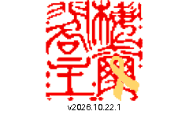
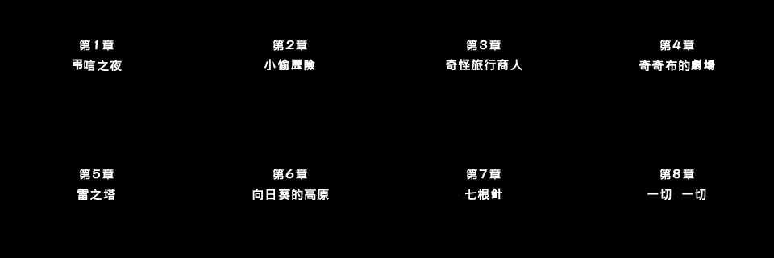

# MOTHER 3: Traditional Chinese ROM tools

Converts the supplied Simplified Chinese 1.2 completion ROM to Traditional
Chinese display, with a separate reviewed build for requested wording and
screen corrections. This is not a completely proofread translation.

The original ROM is never modified. The historical **font-only** builder changes
only two bitmap font banks. The **reviewed** builder additionally changes the
special dialogue font, selected script strings, resource pointers, the opening
graphic, and chapter lettering.
Save logic is unchanged; neither builder accesses user saves.

For gameplay, see the [Traditional Chinese main-story walkthrough](WALKTHROUGH.md),
covering all eight chapters, boss tactics, progression reminders, and a separately
marked final-battle spoiler section.

## v2026.10.31 release

The IPS release patch converts the supplied Chinese 1.2 completion ROM's bitmap
fonts to Traditional Chinese. Apply it only to the source ROM identified below:

- Original Japanese ROM CRC32: `42AC9CB9`
- Chinese 1.2 completion ROM CRC32: `A1E9070D`
- Chinese 1.2 completion ROM SHA-256:
  `b3ed0f1c5c8d53a9537bee32c993b986f38ae57453c882499191f1dbafb31fb3`
- Patch:
  [mother3-zh-Hant-font-only.ips](build/release-20261031/mother3-zh-Hant-font-only.ips)
- Patch SHA-256: `cfd8202e0ce3e90012df3339f59c9fd90410e566f5a9488e5f6437cbef931765`

This is a font-only release patch, not a complete proofread or contextual translation.

### Screenshots

| Welcome screen | Chapter title cards |
| --- | --- |
|  |  |

## Repository contents

This repository includes tools, tests, the character mapping, and replacement
fonts with their license notices. It does not distribute game ROMs, generated
patches, save files, device backups, or the personal welcome logo.
Provide your own legally obtained source ROM matching the required hash.
Reviewed builds also require a logo supplied with `--logo /path/to/logo.png`.

Links into `build/` below refer to local reports and previews, not files hosted
in this repository. Recorded installation and validation results describe the
maintainer's local builds; they are not a fresh test run of a clone.
Bundled font licenses apply to those fonts, not to the game or its translation.

## Reviewed build

The current installed build includes the supplied `yuleshow-chop` logo, the
corrections below, all eight reviewed chapter cards, and the elevator option
`不能乘` -> `不乘` in all 12 floor-selection menus. Installation and read-back
verification are recorded in [the deployment report](build/reviewed-20261022-versioned-v2/deployment.json).
This revision also includes the dry/hair context corrections, `黏土` (55 uses),
and `麵粉` (3 uses) listed below, plus the selected C2 small font and C spacing.
The `3年后` graphic at the Chapter 4 opening, when 硫卡 becomes the protagonist,
remains unresolved.

### 2026-10-22 batch (installed)

The [batch build](build/reviewed-20261022-batch/report.json) includes the pending
`放鬆` correction, `大夥` at all 3 parsed occurrences, and `着` -> `著` at all
744 parsed occurrences. Normal-font `潛` (15 uses) and `鳥` (29 uses) are
verified; their separate special-font equivalents are now converted as well.
The user confirmed `乾燥`, not the previously recorded `乾㘇`.

The Saturn dialogue font now replaces 86 simplified/contextual glyphs across
its 386 inspected slots, including `潛力`, `鳥`, `著`, and `乾燥`.
Unchanged Chinese characters, kana, symbols, and font metrics are preserved.
Replacements use the bundled Fusion Pixel 12px Traditional glyphs inside the
existing 16x16 cells; they do not reproduce the original hand-drawn lettering.
See the [before/after sheet](build/reviewed-20261022-batch/special-font-before-after.png).

The ending dialogue gains its missing opening `「` and a newline before
`◆到此`. Script bank 462 is relocated with all 44 string pointers adjusted,
including the independently referenced suffix. C2 typography, chapter cards,
the opening logo, save logic, and cheats are unchanged from the reviewed tools.

All [63 regression tests](build/reviewed-20261022-batch/tests.log) pass, including
pixel-exact mGBA checks of all 86 replaced special glyphs. The final ROM also
passes [40 C2 renderer checks](build/reviewed-20261022-batch/typography/validation.json)
and [6 isolated boot checkpoints](build/reviewed-20261022-batch/boot/validation.json).
The [validation summary](build/reviewed-20261022-batch/validation.json) verifies
matching artifact hashes and the BPS round-trip. These are isolated checks, not a full playthrough or
complete dialogue-layout validation. The user chose to leave the unidentified
Chapter 4 `3年后` graphic pending. Other unreviewed image lettering may remain.
The superseded `build/reviewed-20261022-batch-rejected-slots` candidate has an
incorrect early glyph mapping and must not be installed.

The batch is **installed**, with device archive and ROM read-back hashes
verified in [the deployment record](build/reviewed-20261022-batch/deployment.json).
Existing archive/member names and all non-ROM members are unchanged, as are
471 save/state/thumbnail files, 11 checked cheat files, and the game list.
The previous C2 archive is backed up in
`build/device-backups/before-20261022-batch-fn3mbt2f/`.
Restart the game and preferably load an in-game save so old instant states do
not restore cached text or font data. Device gameplay remains unverified.

### Welcome version label (installed)

The [versioned build](build/reviewed-20261022-versioned-v2/report.json) displays
`v2026.10.22.1` below the welcome logo and above the existing button prompt.
The logo is moved up eight pixels without resizing. Only the welcome resource
differs from the preceding batch; all text, fonts, and other screens are unchanged.
The version comes from `RELEASE_VERSION` in
[tools/build_screen_patch.py](tools/build_screen_patch.py) and is also recorded
in the build report. Increment it for subsequent releases.

The [validation record](build/reviewed-20261022-versioned-v2/validation.json)
confirms two welcome tests, six emulator boot checkpoints, matching version ink,
unchanged live prompt pixels, and the BPS round-trip. See the
[emulator capture](build/reviewed-20261022-versioned-v2/boot/frame-0240.png).
This build is **installed**, with archive and ROM read-back checksums verified in
[the deployment record](build/reviewed-20261022-versioned-v2/deployment.json).
All 471 save/state/thumbnail files, 11 checked cheat files, the game list, and
non-ROM archive members are unchanged. The preceding batch archive is backed up
in `build/device-backups/before-v2026.10.22.1-6dhi31ax/`.
Restart the game to see `v2026.10.22.1` on the welcome screen.
The earlier `build/reviewed-20261022-versioned` candidate overlaps the live prompt
and must not be installed.

```sh
python3 -m tools.build_rom 'assets/Mother 3 (J)[T+Chn1.2]汉化补完.gba' --c2 --output-dir build/reviewed-20261022-versioned-v2
```

Requires Python 3.10+, Pillow (`python3 -m pip install Pillow`), the checked-in
bitmap fonts, the supplied logo, and macOS's STHeiti Medium chapter font.
Use `--chapter-font /path/to/font` to specify a font explicitly; changing the
font changes the resulting chapter glyphs. The font and logo hashes are recorded.

```sh
python3 -m tools.build_rom 'assets/Mother 3 (J)[T+Chn1.2]汉化补完.gba' --c2 --output-dir build/reviewed-20261022-batch
```

The builder refuses existing output directories and verifies the source hash.
Outputs include `mother3-zh-Hant-reviewed.gba`, `mother3-zh-Hant-reviewed.bps`,
`report.json`, and opening/chapter previews. Apply the BPS only to the exact
Chinese completion v1.2 ROM identified below. BPS includes source, target,
and patch CRCs; its round-trip is checked. IPS cannot address the new resources
above 16 MiB, so the reviewed build deliberately does not produce an IPS.

Run all regression tests with `python3 -m unittest discover -s tests -v`.
Isolated mGBA checks can be reproduced without user saves:

```sh
python3 -m tools.validate_screens build/reviewed-20261021-text-fix-2/mother3-zh-Hant-reviewed.gba --core /path/to/mgba_libretro.dylib --output-dir build/reviewed-boot-check --frames 120 240 600 1200 1800 2400 --press 250 251
python3 -m tools.validate_screens build/reviewed-20261021-text-fix-2/mother3-zh-Hant-reviewed.gba --core /path/to/mgba_libretro.dylib --output-dir build/reviewed-chapter-check --chapters
```

Boot checkpoints cover the new logo and unchanged publisher/main title sequence.
Chapter checks call the actual loader and compare VRAM tiles and copied maps;
the fixture configures display registers for screenshots. These are not a full
playthrough and do not verify chapter fades or device gameplay. New graphics
use VRAM-safe LZ77 with no one-byte back-references.

### Pending corrections

Record new wording reports in this list only. Do not investigate, modify ROM
code, run builds/tests, or deploy each report individually. Wait for the user to
request a batch before implementing and validating the accumulated corrections;
install them together when requested. Reconnecting the device is not a trigger
to deploy pending work.

| Reported text | Correction | Context | Status |
| --- | --- | --- | --- |
| 剃須 | 剃鬚 | User report on 2026-10-25; context not yet specified | Pending batch; not investigated or implemented |
| 烏冬面 | 烏冬麵 | User report on 2026-10-25; context not yet specified | Pending batch; not investigated or implemented |
| 放松 | 放鬆 | 9 parsed occurrences | Tested and installed in the 2026-10-22 batch |
| 3年后 | 3年後 | Chapter 4 opening, when 硫卡 becomes protagonist | Still unidentified; user explicitly deferred on 2026-10-22 |
| 干燥 | 乾燥 | User confirmed this spelling on 2026-10-22, correcting the recorded 乾㘇 | Normal text verified; special-font 乾 installed in the batch |
| 潜力 | 潛力 | Special-font phrase confirmed | Special font converted; normal-font 潛 already correct |
| 大伙兒 | 大夥兒 | 3 parsed 大伙 occurrences | Tested and installed in the batch |
| 鸟 | 鳥 | Normal and special dialogue fonts | Special font converted; 29 normal-font uses verified |
| 着 | 著 | All occurrences, as requested by user | 744 parsed normal-text uses and the special-font glyph converted and installed |
| 世界」在某個時候消亡了。 | 「世界」在某個時候消亡了。 | User screenshot: pair the opening and closing corner quotes around 世界 | Opening quote installed; relocated-bank pointers tested |
| 因此「世界」已經沒有了。◆到此 | Insert a newline after 沒有了。 so ◆到此 starts on the next line | User screenshot: following dialogue runs past the right edge | Newline installed; independently referenced suffix preserved and tested |
| 土星先生 dialogue appears entirely in Simplified Chinese | Convert the separate special-font glyphs to Traditional Chinese | Separate 16x16 font mode 2 | 86 glyphs converted, pixel-tested, and installed |

#### Special dialogue font implementation

The reported special font uses mode 2, selected at ROM offset `0xA16C`,
with bitmap data at `0xD0D9F8`. The glyph resolver at `0x9D6C` uses a
32-byte stride for this mode; the renderer at `0x9394` reads 16x16 glyphs.
This is a separate encoding from the ordinary Chinese banks: for example,
slots `0x51`, `0x52`, `0x5B`, `0x5D`, `0x60`, and `0x6C` visibly contain
`这`, `边`, `谢`, `颜`, `来`, and `鸟`.

The initial [inspection sheet](build/saturn-font-check/original-font2.png)
confirmed the Simplified forms in the preceding C2 revision. The installed
2026-10-22 batch expands the inspection through slot `0x181`
and fingerprints all 12352 bytes before patching. Each glyph stores its left
16 rows followed by its right 16 rows, with MSB-first pixels. The special
encoding is independent of ordinary Chinese slots starting at `0x300`.

All 86 replacement slots are checked through the actual resolver at `0x9D6C`
and renderer at `0x9394`; untouched slots are byte-identical to the source.
The isolated fixture starts after boot initialization, which otherwise clears
its font descriptor in high EWRAM. Gameplay dialogue layout remains unverified.

#### Superseded local wording build

The local [C2 wording update](build/reviewed-20261021-c2-relax/report.json)
corrects all 9 parsed occurrences of `放松` to `放鬆`. Other uses of `松`
outside the reviewed `輕鬆` and `放鬆` phrases are preserved. All 59 regression
tests pass. Comparison with the installed C2 ROM confirms that only these text
positions, including the relocated common-bank copy, changed; fonts, spacing,
and all other ROM content are unchanged. The BPS round-trip also passes.
The initial installation attempt was blocked by a disconnected device share.
This update is now included in the larger 2026-10-22 local batch above.

```sh
python3 -m tools.build_rom 'assets/Mother 3 (J)[T+Chn1.2]汉化补完.gba' --c2 --output-dir build/reviewed-20261021-c2-relax
```

### Selected C2 typography (installed)

The selected typeface is **C2**, native Fusion Pixel 10px with 9x9 ink,
using **C spacing**, an 11px cell advance. The original C2 build is in
[build/reviewed-20261021-c2](build/reviewed-20261021-c2/report.json).
The [deployment record](build/reviewed-20261021-c2/deployment.json) confirms the
read-back ROM hash, unchanged archive names and other members, unchanged game
list, and all 159 current save/state/thumbnail files. The preceding text-fix-2
archive is backed up in `build/device-backups/before-c2-1s2pakcg/`.

```sh
python3 -m tools.build_rom 'assets/Mother 3 (J)[T+Chn1.2]汉化补完.gba' --c2 --output-dir build/reviewed-20261021-c2
```

This optional mode also requires devkitARM's `arm-none-eabi-as` and
`arm-none-eabi-objcopy` under `/opt/devkitpro/devkitARM/bin`.
It replaces 3327 small Chinese glyph slots, including unchanged simplified/
traditional forms and contextual additions. The existing 9x9 supplements supply
`叄` and `磣`. Fusion Pixel lacks `嘬`, which appears once in parsed text;
its original 10x10 bitmap is explicitly retained without scaling or clipping.
The large font, wording corrections, and chapter/logo resources are unchanged.

Small-font initialization uses 11px width while retaining the 20-byte glyph
stride. Two legacy small-font width initializers are adjusted as well.
The original instructions and free relocation area are checked before patching.
The normal builder still reproduces the preceding reviewed ROM without C2.

All 59 regression tests pass, including mGBA initializer checks for selected and
unaffected fonts and exact allowed differences from the reviewed ROM. Reproduce
the isolated pixel validation with:

```sh
python3 -m tools.validate_screens build/reviewed-20261021-c2/mother3-zh-Hant-reviewed.gba --core /path/to/mgba_libretro.dylib --output-dir build/c2-pixels --typography
```

[Pixel validation](build/reviewed-20261021-c2/typography/validation.json) checks
40 cases through the actual initializer and glyph renderer, comparing every
tile-buffer pixel across eight horizontal alignments. Buffer accessors are
stubbed and the fixture supplies text positions; this is not a test of complete
menu layout, automatic wrapping, or gameplay. The
[rendered samples](build/reviewed-20261021-c2/typography/rendered-samples.png)
are isolated renderer output, not game screenshots. No user saves are accessed.
Full-game layout verification remains pending. Restart the game after installing
this version; loading an old instant state can restore cached font metrics.

### Crash investigation: states 99 and 100

The user reported two freezes along the same route, with state 99 saved before
the failure and state 100 saved afterward; loading 100 freezes and later exits
on the device. Restarting subsequently allowed play to continue. The reported
enabled cheats were HP/PP, no encounters, and experimental enemy-only one-hit.
This combination has not been established as the cause.

Read-only device copies and screenshots are preserved in
[build/crash-99-100-hZlE3K](build/crash-99-100-hZlE3K). Both state copies match
the device SHA-256 hashes, and all RZIP blocks pass decompression/checksum and
length checks. State 100 already contains an ARM undefined-instruction exception
(`PC=0x3C`, `CPSR=0x9B`), rather than just a damaged compressed file.

Using the installed C2 ROM's local copy and the device's copied GBA BIOS,
[state 99's replay](build/crash-99-100-hZlE3K/replay99-long/replay.log) runs
10,800 frames without that exception, while
[state 100's replay](build/crash-99-100-hZlE3K/replay100-bios/replay.log) stays
in exception handling with unchanged VRAM. Neither replay applies cheats or
controller input. This is about three minutes of emulated time, not a replay
of the user's route or battle. The local newer mGBA core does not itself exit;
the device-side delayed emulator exit and original trigger remain unverified.
Both states require the matching BIOS because their saved PCs are inside BIOS
code; the initial built-in-BIOS control was rejected even for state 99.

For now, retain state 99, avoid resuming 100, disable one-hit/no-encounters for
this route, and restart content to clear in-memory cheat patches. Load a known
good state or in-game save, not the already-failed state. No device ROM, cheat,
save, or configuration was changed. Local replay uses
`python3 -m tools.validate_crash_state ROM COPIED_STATE --core CORE --system-dir LOCAL_BIOS_DIR --output-dir NEWDIR --frames 10800`.

## Historical font-only build

Requires Python 3.10 or newer; no Python packages or network access are needed.

```sh
python3 tools/build_font_patch.py 'assets/Mother 3 (J)[T+Chn1.2]汉化补完.gba'
```

The builder refuses any ROM other than the exact 32 MiB input:

```text
SHA-256: b3ed0f1c5c8d53a9537bee32c993b986f38ae57453c882499191f1dbafb31fb3
```

Outputs in `build/`:

- `mother3-zh-Hant-font-only.gba`: locally converted ROM.
- `mother3-zh-Hant-font-only.ips`: patch for the **Chinese completion ROM**, not
  the original Japanese release.
- `report.json`: hashes, conversion counts, verified invariants, and limitations.

Existing outputs are not overwritten. Use `--output-dir another-directory` for
another build. Keep your original ROM and saves. Save format and code are
unchanged, and one copied existing emulator save state has been tested with the
font-size correction. Other save types and states have not been validated;
emulators may also require a matching ROM/save filename.

IPS does not store a source checksum. When applying the IPS in another tool,
verify the source hash yourself. Do not apply it to another translation/version.
No ROM is downloaded or uploaded by the build process. Do not redistribute ROMs.

## Device installation: keep the existing name

The permanent device path is:

```text
/Volumes/share/roms/gba/Mother 3 (Japan).zip
```

Keep this exact filename for every future ROM update, despite its existing
`(Japan)` label. Replace the ROM inside that archive without changing its
existing member name:

```text
Mother3汉化补完版/Mother 3 (J)[T+Chn1.2]汉化补完.gba
```

Preserve the other archive members and the device game list. Do not install a
separate `mother3-zh-Hant.gba` or append version numbers to the device filename.
Back up the original archive locally, not as another game on the device.
The initial backup is in `build/device-backups/`; the installed ZIP package is
in `build/device-deployment/`. Verify both the transferred archive checksum and
the inner ROM checksum against the build report when deploying updates.

The C2 reviewed build is installed under this same name. The preceding text-fix-2
revision is backed up locally in `build/device-backups/before-c2-1s2pakcg/`.
The [deployment record](build/reviewed-20261021-c2/deployment.json) verifies the
installed archive and ROM hashes, unchanged non-ROM members, unchanged game
list, and all 159 existing game save/state/thumbnail files. Restart the game
after updating; old instant states may retain cached text and font metrics.
The earlier [font-only deployment record](build/font-size-fixed/deployment.json)
and its backups remain available as historical records.

## Scope and limitations

### Optional RetroArch cheats

The separate cheat file is installed at
`/Volumes/share/cheats/cht/0QuickLoad/Mother 3 (Japan) - HP PP DP EXP.cht`.
Existing cheat files, ROMs, and saves are not modified.
It targets the mGBA core and contains six disabled-by-default options:
in-battle HP/PP (press R), unlimited PP use outside battle, 999,999 DP
available to withdraw from Chapter 4 onward, double EXP after battle,
no encounters (walk through enemies; the party blinks), and an experimental
Chinese-v1.2 no-blink alternative copied from the existing
`/Volumes/share/cheats/cht/0QuickLoad/Mother3-no-blink-test.cht`.
On 2026-10-21, the existing DP option was initially relabeled "Infinite money".
After a report that the wallet/shop amount did not change, its device label was
clarified to **Bank DP 999999 - withdraw at frog (Ch4+) - NOT wallet**.
Its code and all enable states are unchanged. Reload the cheat file, enable this
option, select **Apply Changes**, then use a save frog's **DP > Withdraw** menu
from Chapter 4 onward. The wallet/shop amount is not filled directly.
The original cheat file is backed up locally in
[build/device-backups/Mother 3 - HP PP DP EXP.before-money-label-20261021.cht](build/device-backups/Mother%203%20-%20HP%20PP%20DP%20EXP.before-money-label-20261021.cht).
The intermediate label is backed up in
[build/device-backups/Mother 3 - HP PP DP EXP.before-bank-clarification-20261021.cht](build/device-backups/Mother%203%20-%20HP%20PP%20DP%20EXP.before-bank-clarification-20261021.cht).
The [DP probe](tools/validate_dp.py) verified that mGBA's actual cheat parser
writes 999,999 to `0x02019544` in the current font-size-fixed ROM; the no-cheat
control retained 123. This isolated RAM test does not verify bank withdrawal or
shop gameplay on the device and does not load or write user saves. Reproduce:

```sh
python3 -m tools.validate_dp build/font-size-fixed/mother3-zh-Hant-font-only.gba '/Volumes/share/cheats/cht/0QuickLoad/Mother 3 (Japan) - HP PP DP EXP.cht' --core /path/to/mgba_libretro.dylib
```

The no-blink alternative patches game code in memory and is not
gameplay-verified. Enable only one no-encounters option at a time.
Restart the game after disabling the no-blink option to clear code patches.
No encounters may not prevent scripted/boss battles; disable it before
required story encounters. No one-hit-kill code is included: the documented
instant-KO code also affects the player party and was declined. A separate,
local enemy-only experimental candidate is described below; it has not been
added to the installed combined cheat file.

Back up saves before use. In RetroArch, open **Quick Menu > Cheats > Load
Cheat File (Replace)**, select the file, enable the desired options, then
select **Apply Changes**. Disable cheats when no longer needed; turning a
cheat off does not undo EXP or DP already saved.

The HP/PP and no-encounters codes come from the
[Libretro database](https://github.com/libretro/libretro-database/blob/master/cht/Nintendo%20-%20Game%20Boy%20Advance/Mother%203%20%28Japan%29.cht);
DP and double EXP come from this
[MOTHER 3 code thread](https://gamefaqs.gamespot.com/boards/914622-mother-3/46447417).
These are Japanese-version codes, not verified gameplay fixes for the Chinese
completion ROM. File structure is checked, but gameplay compatibility remains
unverified. Local mGBA runtime validation was blocked by a missing
`libavcodec.62.dylib` dependency.

### Experimental enemy-only one-hit KO

The local [experimental cheat](build/enemy-one-hit/Mother%203%20(Japan)%20-%20Enemy%20One%20Hit%20EXPERIMENTAL.cht)
targets the **mGBA core and Chinese completion v1.2 ROM**, including this
project's current Traditional Chinese font-size-fixed build. It has one option,
disabled by default. It was installed on 2026-10-20 in
`/Volumes/share/cheats/cht/0QuickLoad/` under the same filename. The
[deployment record](build/enemy-one-hit/deployment.json) confirms that the
transferred cheat matches the local file and the device ROM matches the tested
build. No ROM or save files were written. The earlier validation report records
the pre-installation state; gameplay verification is still pending.

The [assembly candidate](tools/enemy_one_hit.s) changes only the 44-byte
`Monster::setHP` function at `0x08081494` in emulator memory. An ordinary enemy
HP decrease becomes zero; healing, initialization, and zero-damage calls are
preserved. The global protected-battle branch retains its original behavior.
The player HP setter and ROM files on disk are not changed.

**Not gameplay-verified.** The [validation report](build/enemy-one-hit/validation.json)
records 120 isolated mGBA checks using synthetic objects, a stubbed protection
predicate, the real player HP setter, and the actual libretro cheat parser.
These are not complete battles. Any HP decrease through this enemy setter,
including poison or scripted reductions, can trigger KO. Custom enemy setters
and story behavior remain unverified. Back up saves, test on an ordinary enemy,
and disable before scripted/boss encounters. Restart the content after disabling
to ensure all code patches are cleared. A copied battle save/state is needed
for the next gameplay check; original saves must remain untouched.

The candidate is based on the public MOTHER 3 decompilation's
[enemy setter](https://github.com/Kurausukun/mother3/blob/master/src/battle/monster.cpp)
and [unit setter](https://github.com/Kurausukun/mother3/blob/master/src/battle/unit.cpp),
with their instructions checked against the local ROM. Action Replay ROM-patch
addresses use **halfword offsets**, not byte offsets. Encoding tests check the
round-trip, and the cheat is executed by mGBA rather than assumed compatible.

Reproduce with devkitARM's ARM GNU tools and an external mGBA libretro core:

```sh
arm-none-eabi-as -o /tmp/mother3-enemy-one-hit.o tools/enemy_one_hit.s
arm-none-eabi-ld -Ttext=0x08081494 -e enemy_one_hit -o /tmp/mother3-enemy-one-hit.elf /tmp/mother3-enemy-one-hit.o
arm-none-eabi-objcopy -O binary /tmp/mother3-enemy-one-hit.elf /tmp/mother3-enemy-one-hit.bin
python3 tools/validate_enemy_one_hit.py build/font-size-fixed/mother3-zh-Hant-font-only.gba --patch /tmp/mother3-enemy-one-hit.bin --core /path/to/mgba_libretro.dylib --output-dir build/enemy-one-hit-check
```

The validator refuses unsupported ROM hashes and existing output directories.
It does not load or write user saves. The independent encoding tests run with
the normal project test command below, without emulator dependencies.

### Historical font-only conversion

- Per-character defaults were generated with OpenCC 1.4.0 `s2t`, without Taiwan
  or Hong Kong vocabulary substitution. The checked-in map makes builds
  independent of the locally installed OpenCC version.
- A single glyph slot cannot display different contextual variants. For example,
  the same simplified character may need different Traditional characters in
  different words. This prototype does not solve that ambiguity.
- Text drawn into images, title graphics, and fonts outside the two confirmed
  banks remains unchanged.
- The map was reverse-engineered locally using bitmap inspection, macOS Vision
  OCR of both font sizes, and identical-glyph matching against an ordered GB2312
  tail. OCR conflicts were visually reviewed, but remaining identification errors
  are possible. Evidence is recorded per slot in [data/charset.tsv](data/charset.tsv).
- Small Traditional glyphs can be dense on the GBA display. This is a first
  version for testing, not a fully proofread or fully playtested release.

## Reviewed corrections

Requested on 2026-10-19 through 2026-10-21. Status refers to the current reviewed
build installed on the device, not the historical font-only build.

| Previous display | Required display | Status |
|---|---|---|
| 關系 | 關係 | 19 occurrences corrected |
| 聯系 | 聯繫 | 4 corrected |
| 家夥 | 傢伙 | 261 corrected |
| 肉幹 | 肉乾 | 6 corrected |
| 幹旱 | 乾旱 | 1 corrected |
| 幹燥 | 乾燥 | 7 corrected |
| 烘幹 | 烘乾 | 3 corrected |
| 幹淨 | 乾淨 | 11 corrected |
| 餅幹 | 餅乾 | 18 corrected |
| 幹杯 | 乾杯 | 2 corrected |
| 幹脆 | 乾脆 | 1 corrected |
| 幹涸 | 乾涸 | 1 corrected |
| 幹冰 | 乾冰 | 1 corrected |
| 魚幹 | 魚乾 | 1 corrected |
| 衣服幹 | 衣服乾 | 5 corrected |
| 頭發 | 頭髪 | 3 corrected |
| 假發 | 假髮 | 10 corrected |
| 長發 | 長髪 | 1 corrected |
| 發型 | 髪型 | 3 corrected |
| 卷發 | 捲髪 | 1 corrected |
| 洗發 | 洗髪 | 1 corrected |
| 理發 | 理髪 | 1 corrected |
| 粘土 | 黏土 | 55 corrected |
| 面粉 | 麵粉 | 3 corrected |
| 控制杆 | 控制桿 | 3 corrected |
| 輕松 | 輕鬆 | 13 corrected |
| 坏 | 壞 | Glyph identification corrected; 113 referenced uses |
| 3年后 | 3年後 | Pending: graphic not yet identified |
| 面包 | 麵包 | 28 corrected |
| 蘇醒 | 甦醒 | 8 corrected |
| 盖 | 蓋 | Already converted in the font build |
| 只 (classifier) | 隻 | 29 reviewed uses corrected; 197 other uses preserved |
| 不能乘 (elevator option) | 不乘 | 12 corrected; trailing space preserves menu length |

The phrase corrections use pointer-referenced literal text, excluding control
arguments and unrelated binary matches. They are not global glyph substitutions.
Preserve `系` in `系統`, `家` in `家人`, `幹` in `幹活`, `發` in `發生`, `面` in `見面`, and `蘇` in `紫蘇`;
these contexts retain their original character IDs. Newly allocated glyph slots
are absent from all parsed script/menu text and include both verified font sizes.
For ordinary hair terms, the requested character is specifically `髪`, not `髮`;
for `假髮`, it is `髮`. All 127 referenced `干` and 248 referenced `发` positions
were reviewed for this revision; tests verify the corrected phrases and preserve
all remaining uses. This audit covers parsed script/menu text, not bitmap lettering.
The earlier phrase list missed these contexts; testing only that list was not a
complete ambiguity audit. The current regression suite contains 55 passing tests.

### Chapter titles and opening screen

The very first warning graphic is replaced with the supplied logo. Its original
button prompt, input handling, and transition timing remain unchanged.
The main MOTHER 3 title and credits remain unchanged.

All eight chapter cards were decoded and reviewed: `弔唁之夜`, `小偷歷險`,
`奇怪旅行商人`, `奇奇布的劇場`, `雷之塔`, `向日葵的高原`, `七根針`,
and `一切 一切`. The installed 2026-10-22 revision changes only six character
cells; the chapter-number lines, other characters, positions, palette, and
VRAM allocation are preserved in that revision.
These are bitmap graphics, independent of ordinary dialogue fonts.

Local update on 2026-10-24: All eight titles now redraw every Chinese character
(36 cells total) with the same font, size, stroke, and baseline. This supersedes
the earlier Chapter-1-only candidate. The chapter-number lines, pixels outside
the title band, palette, and VRAM allocation remain unchanged. Titles retain
their original horizontal layout, including Chapter 8's narrower separator;
the old stray pixel beside Chapter 7's first cell is cleared. Shared font
metrics preserve natural vertical placement, including the single stroke of
`一`, without clipping glyphs. The C2 ROM, BPS patch, and previews are in
`build/all-chapter-titles-20261024`; this update is not deployed. Both chapter
regression tests and the BPS round-trip pass. The preview sheet was visually
checked; actual emulator loading remains unverified because the local mGBA
core is unavailable.

### Dialogue correction

The Chapter 3 desert screenshot reported on 2026-10-20 displays
`說了誰跳舞！`. The reviewed build changes it to `誰叫你跳舞了？！`.
The [English script reference](https://github.com/Kurausukun/mother3/blob/master/eng_script.txt#L295)
has entry `0-116`, "Who told you to dance?!", beside similar reprimands for
backflipping and laughing. Chapter 3 entries `30-9` and `30-10` establish the
requirement to follow the speaker's commands. This supports a reprimand for
dancing without being told, rather than an instruction to start dancing.
The Chinese ROM's common-bank entry `0-116` was verified against its exact
glyph IDs. The longer replacement uses a relocated common bank with adjusted
string pointers. Regression tests verify the effective relocated dialogue.
The Japanese wording has not been independently checked.

### Dialogue Easter egg to preserve

User decision on 2026-10-21: retain the screenshot's wording
`不能像南京法官那樣用常理來分析。` as an Easter egg during future proofreading
and dialogue revisions. Do not remove or replace the `南京法官` reference.
It alludes to the internet controversy surrounding the 2006 Nanjing Peng Yu
case, satirizing reliance on supposed common sense. It appears to be a localized
joke; its origin in the Chinese translation has not been confirmed against the
Japanese script. The reviewed build verifies that this line's bytes remain
unchanged in the relocated common bank.

## Verified binary layout

| Font | ROM start | End (exclusive) | Slots | Record layout |
|---|---:|---:|---:|---|
| Main text | `0xCE39F8` | `0xCF99F8` | 4096 | 11 rows, two MSB-first bytes per row |
| Small/menu text | `0xCF99F8` | `0xD0D9F8` | 4096 | 10 rows, two MSB-first bytes per row |

Slots below `0x300` (symbols and non-Chinese characters) are preserved.
Slots `0x300` through `0xC9F` use the translation's custom ordering.
The main-font tail `0xCA0` through `0xFFF` follows GB2312 order: for glyph ID `i`,
the zero-based GB2312 grid index is `i + 290`. Its identical bitmaps independently
identify 544 custom slots. The builder neither rescales nor clips glyphs.
The small-font derivative is adapted offline as described below.

The build validates the input hash, checked-in font hashes, complete character
map, glyph availability and bounds, IPS round-trip, and preservation of all
non-font bytes. It does **not** treat these checks as a full-game playthrough.

### Small-font size correction

The first release mixed original 10x10 battle/menu glyphs with replacement
9x9 glyphs placed one pixel lower. The current small-font derivative fills the
10x10 cell and aligns its top with the original font. The larger 11-row dialogue
font, character mappings, scripts, and all unchanged characters are unaffected.

[M3 Traditional Full Cell](data/fonts/mother3-traditional-full-cell-10px.bdf)
adapts the original replacement bitmaps by inserting one internal row and
column. Crossing strokes are continued rather than doubling a complete row or
column with nearest-neighbor scaling. Each glyph retains every source pixel;
foreground and background component counts under both four- and eight-way
connectivity must remain identical. The narrowest glyph retains its naturally
narrower width. Tests check all 961 distinct replacement characters, including
the exact 10x10 size and top alignment of `擊、點、經、驗、圖`.

The derivative can be reproduced without extra packages:

```sh
python3 -m tools.expand_small_font --output /tmp/mother3-full-cell-10px.bdf
```

The generator refuses to overwrite an existing output. It preserves pixel
structure, but does not replace visual proofreading of dense Traditional
characters at this small resolution.

## Tests

```sh
python3 -m unittest discover -s tests -v
```

The font-size correction passes all **25 tests**, including full-set size,
alignment, source-pixel retention, and stroke-topology checks. Comparison with
the preceding ROM confirms that only the small-font bank changed.

A headless mGBA test loaded a local copy of an existing device save state using
the device's BIOS, then ran both versions with identical input for 194 frames.
The field and initial menu matched exactly; inventory and key-item screens
showed the corrected font. Rendered `牆、鉤、煙、霧、彈、圖` matched the expected
10x10 bitmaps pixel-for-pixel. See the
[before/after gameplay comparison](build/font-size-fixed/font-size-comparison.png)
and [validation record](build/font-size-fixed/font-size-validation.json).
Original saves were not modified. This is a menu/save-state smoke test, not a
full playthrough or a test of every battle screen or battery-save loading.

The initial build passed all 19 tests. A separate headless mGBA smoke test ran
the original and converted ROMs for 1,696 frames with identical button input.
Their three boot checkpoints matched exactly; the naming screen displayed the
new Traditional glyphs, with pixel differences confined to the character
description text. See the local [visual comparison](build/preview.png) and
[smoke-test record](build/validation.json). This checks boot and naming only,
not later gameplay, save loading, or every menu.

## Font licenses and sources

Replacement bitmaps come from the **monospaced zh-Hant** variants of
[Fusion Pixel Font 2026.10.16](https://github.com/TakWolf/fusion-pixel-font/releases/tag/2026.10.16),
by TakWolf and its upstream font contributors, under SIL Open Font License 1.1.
Original BDF files are included without modification. Their upstream notices
and licenses are retained in [data/fonts/](data/fonts/). Keep the applicable
font notices/licenses with redistributed patches.
The separately named full-cell derivative uses the same SIL OFL 1.1 license.

The upstream 10px font lacks `磣` and `叄`. A separately named, OFL-licensed
[supplement](data/fonts/mother3-traditional-supplement-10px.bdf) supplies
hand-composed 9x9 bitmaps, using the existing `砍`/`滲` components and
`參`/`叁` components respectively. These two very small glyphs especially need
in-game readability review. There is no blank-glyph substitution or automatic
downscaling.

Sources:

- [10px BDF archive](https://github.com/TakWolf/fusion-pixel-font/releases/download/2026.10.16/fusion-pixel-font-10px-monospaced-bdf-v2026.10.16.zip)
- [12px BDF archive](https://github.com/TakWolf/fusion-pixel-font/releases/download/2026.10.16/fusion-pixel-font-12px-monospaced-bdf-v2026.10.16.zip)
- [OpenCC](https://github.com/BYVoid/OpenCC)
- [RopeSnake](https://github.com/jeffman/RopeSnake) was consulted for format
  research; the converter does not import its code or modify text banks.
